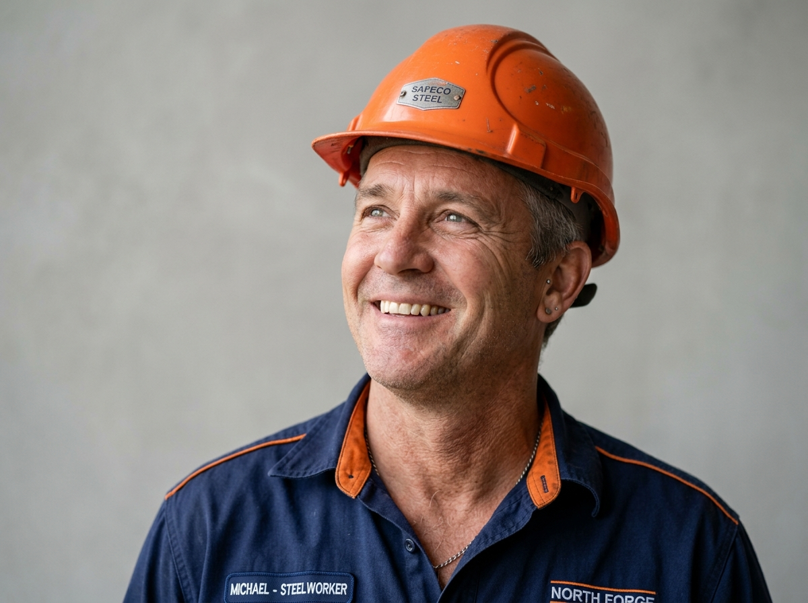

# NIVA Power Industries — Official Website

> A premium, fully handcrafted **multi-page corporate website** for NIVA Power Industries — a heavy electrical infrastructure and structural steel manufacturer. Built entirely with **Pure Vanilla HTML5, CSS3, and ES6+ JavaScript** — no frameworks, no libraries, no dependencies.

---

## 📋 Table of Contents

1. [Project Overview](#1-project-overview)
2. [Technology Stack](#2-technology-stack)
3. [Project File Structure](#3-project-file-structure)
4. [Pages Overview](#4-pages-overview)
   - [index.html — Home Page](#41-indexhtml--home-page)
   - [about.html — About Us](#42-abouthtml--about-us)
   - [products.html — Products Catalog](#43-productshtml--products-catalog)
   - [media.html — Media & Press](#44-mediahtml--media--press)
   - [contact.html — Contact & RFQ](#45-contacthtml--contact--rfq)
5. [CSS Design System](#5-css-design-system)
   - [Design Tokens (CSS Custom Properties)](#51-design-tokens-css-custom-properties)
   - [Color Palette](#52-color-palette)
   - [Typography](#53-typography)
   - [Spacing & Layout Scale](#54-spacing--layout-scale)
   - [Shadows & Transitions](#55-shadows--transitions)
6. [Layout Architecture](#6-layout-architecture)
   - [Global Container System](#61-global-container-system)
   - [Architectural Grid Guidelines](#62-architectural-grid-guidelines)
   - [The 3-Column Layout System](#63-the-3-column-layout-system)
   - [Reveal Animation System](#64-reveal-animation-system)
7. [JavaScript Features](#7-javascript-features)
8. [Shared Components](#8-shared-components)
   - [Sticky Header & Navigation](#81-sticky-header--navigation)
   - [Dark Industrial Footer](#82-dark-industrial-footer)
9. [Image Assets](#9-image-assets)
10. [SEO & Accessibility](#10-seo--accessibility)
11. [How to Run](#11-how-to-run)

---

## 1. Project Overview

**NIVA Power Industries** is a fictional industrial company specialising in:
- Compact Secondary Substations & Power Distribution
- Structural Steel Manufacturing
- Eco-Sustainable Steelmaking (Electric Arc Furnace)

The website communicates the brand's authority, innovation, and sustainability story through a premium architectural layout — inspired by top-tier industrial brands. Every section has been crafted pixel-by-pixel to match a reference design, using **CSS Grid, Flexbox, IntersectionObserver, and subtle micro-animations**.

---

## 2. Technology Stack

| Layer | Technology | Notes |
|---|---|---|
| **Markup** | HTML5 | Semantic elements (`<header>`, `<main>`, `<section>`, `<article>`, `<footer>`, `<nav>`) |
| **Styling** | Pure Vanilla CSS3 | CSS Custom Properties, Grid, Flexbox, Keyframe Animations |
| **Scripting** | Vanilla JavaScript (ES6+) | No jQuery, no frameworks |
| **Fonts** | Google Fonts | `Plus Jakarta Sans` (primary) + `JetBrains Mono` (mono) |
| **Icons** | Inline SVG | All icons are inline SVGs — zero extra HTTP requests |
| **Images** | Local `.jpg`, `.png`, `.svg` | All assets stored in `images/` folder |

---

## 3. Project File Structure

```
niva-industries-website/
│
├── index.html              ← Home Page (Hero, Stats, Products, Careers, Newsroom…)
├── about.html              ← About Us (Heritage, Stats, Values, CEO, Timeline…)
├── products.html           ← Products Catalog (Filtered grid of 8 product types)
├── media.html              ← Media & Press (Featured story, Press releases, Gallery)
├── contact.html            ← Contact & RFQ Form (Inquiries, Form, Footer)
│
├── css/
│   └── style.css           ← Single master stylesheet (~5600 lines, fully documented)
│
├── js/
│   └── script.js           ← Single master JS file (~380 lines, modular sections)
│
└── images/                 ← 63 image assets (JPGs, PNGs, SVGs)
    ├── logo.svg
    ├── favicon.svg
    ├── hero-superstructure.jpg
    ├── product-*.jpg / .svg
    ├── about-*.jpg / .png
    ├── media-*.jpg
    ├── news-*.jpg
    ├── contact-*.jpg
    └── ... (63 total files)
```

> **Key Principle:** One CSS file + One JS file — shared across all 5 pages. This keeps the codebase lean and ensures consistent behavior everywhere.

---

## 4. Pages Overview

### 4.1 `index.html` — Home Page

The most complex page. Contains **10 distinct sections** plus the master footer.

| # | Section Name | CSS Class | Description |
|---|---|---|---|
| 1 | **Hero** | `.exact-hero-section` | Full-bleed hero image with massive editorial headline and "Learn More" action bar |
| 2 | **Overview & Feature Cards** | `.exact-overview-section` | 3-column stats row (100% / 90% recyclability metrics) + 3 feature square cards |
| 3 | **Architectural Statement** | `.architectural-statement-section` | Split 3-column heading, stepped banner image, solution directory links |
| 4 | **Eco Innovation** | `.exact-dark-section` | Dark background section with accordion panels (Process Technology / Product Technology) |
| 5 | **Sustainable Steel Products** | `.exact-products-section` | Asymmetric product catalog grid: DSAW Pipe, Carbon Steel Plate, Hot Rolled Coil |
| 6 | **Careers Split Banner** | `.exact-careers-section` | 50/50 photo + orange panel split layout with career CTA |
| 7 | **Newsroom** | `.newsroom-section` | 3-column press release cards with offset media frames |
| 8 | **Video Showcase** | `.video-showcase-section` | Wide cinematic banner with center play button + stock ticker bar |
| 9 | **Advancing Steel Industry** | `.robotics-panorama-section` | Full-width robotics panorama + 3 report download links |
| 10 | **Advancements CTA** | `.architectural-facade-section` | Left image / right text split with "LET'S TALK" CTA |

> **Note:** Sections 2 and 3 share a `div.continuous-3col-wrapper` — a single continuous 3-column architectural guide line runs visually across both sections without interruption.

---

### 4.2 `about.html` — About Us

Six main sections telling the brand heritage story.

| # | Section Name | CSS Class | Description |
|---|---|---|---|
| 1 | **Architectural Hero** | `.about-hero-section` | Full-bleed corrugated steel panorama + 3-column text grid with breakthrough content |
| 2 | **Cylinder Showcase** | `.about-cylinder-showcase-section` | Steel cylinder background with 3 stepped stat cards (25K Products / 10K Inspections / 400+ Suppliers) |
| 3 | **Best Experience** | `.about-experience-section` | Dark section with experience tab links (Eco Innovation / R&D Labs / ISO Certification) |
| 4 | **Core Values** | `.about-values-section` | 3-column values grid: Think Big / Never Settle / Be Collaborative |
| 5 | **Generations of Excellence** | `.about-excellence-section` | Left photo / right content split with pinned corner CTA button |
| 6 | **Inception & Heritage** | (continuation) | CEO profile section, corporate building image, timeline milestones |

---

### 4.3 `products.html` — Products Catalog

An **interactive filtered product grid** presenting 8 product types.

**Filter Buttons:**
```
[ All Solutions (8) ]  [ Structural Steel ]  [ Coils & Sheets ]
[ Reinforcement ]  [ Pipes & Conduits ]  [ Forging & Plates ]
```

Each product card uses a `data-category` attribute. JavaScript filters cards by toggling the `.card-hidden` CSS class.

**Products in the Catalog:**

| Product Name | Category |
|---|---|
| Structural H-Beams (ASTM A992) | `structural` |
| Hot-Rolled Coil | `flat` |
| DSAW Pipe (API 5L) | `pipes` |
| Carbon Steel Plate | `forging` |
| Seamless Pipes | `pipes` |
| Deformed Rebar (TMT) | `rebar` |
| Galvanized Sheet | `flat` |
| Custom Forgings | `forging` |

---

### 4.4 `media.html` — Media & Press

A magazine-style editorial layout for press releases and news stories.

**Layout:**
- **Top Row:** Featured press release — wide 2-column: headline text left, large facade image right
- **Bottom Row:** 3-column grid of press cards (each with image frame, category tag, headline)

**Published Stories:**
1. *How Iron and Steel Fuelled the Industrial Revolution* — Featured Story
2. *FABRIK Closes on $240 Million Financing to Support Big River 2* — Press Release
3. *What GreenBiz 2023 Tells Us About the Future of Sustainability* — Product Innovation
4. *Market Conditions, Value Over Volume and Sustainability* — Press Release

---

### 4.5 `contact.html` — Contact & RFQ

Two main sections. No sidebar — clean and focused.

**Section 1 — Contact Hero (`#contact-hero`):**
- Architectural title: "READY TO MEET YOUR STEEL PARTNER?"
- Full-width panoramic aerial coaster image
- 3-column inquiry directory:
  - **General Inquiries** — Address + Phone + Email
  - **Product Sales Inquiries** — Sales phone + Business hours
  - **Supplier Inquiries** — Supplier contact details + Business hours

**Section 2 — Inquiry Form (`#contact-form`):**
- Left (2/3 width): Multi-field form
  - First Name, Last Name (2-col row)
  - Email Address, Phone Number (2-col row)
  - Company Name, Company Address (2-col row)
  - Comments/Questions (full-width textarea)
  - SUBMIT button with arrow
- Right (1/3 width): Steel truss photo as visual
- Client-side validation via JavaScript
- Successful submit triggers a toast notification

---

## 5. CSS Design System

### 5.1 Design Tokens (CSS Custom Properties)

All design values are declared as **CSS Custom Properties** in the `:root {}` block at the top of `style.css`. This is the single source of truth for the entire design system.

```css
:root {
  /* Colors */
  --color-primary:      #0B0F17;
  --color-accent:       #FF4D00;
  --color-white:        #FFFFFF;
  --color-bg-light:     #F8FAFC;

  /* Typography */
  --font-primary: 'Plus Jakarta Sans', sans-serif;
  --font-mono:    'JetBrains Mono', monospace;

  /* Spacing */
  --spacing-md:  1rem;    /*  16px */
  --spacing-xl:  2.5rem;  /*  40px */
  --spacing-3xl: 6rem;    /*  96px */

  /* Elevation */
  --shadow-lg: 0 12px 30px rgba(15, 23, 42, 0.12);
  --shadow-accent: 0 8px 24px rgba(255, 77, 0, 0.28);

  /* Motion */
  --transition-base: 0.35s cubic-bezier(0.16, 1, 0.3, 1);

  /* Layout */
  --container-max:  1320px;
  --header-height:  80px;
}
```

---

### 5.2 Color Palette

| CSS Token | Hex Value | Role |
|---|---|---|
| `--color-primary` | `#0B0F17` | Main dark background (navy-black) |
| `--color-primary-light` | `#151B26` | Lighter dark panels |
| `--color-surface-dark` | `#1E2638` | Dark surface / card backgrounds |
| `--color-dark-border` | `#2A3449` | Borders on dark backgrounds |
| `--color-accent` | `#FF4D00` | **Signature Industrial Orange** — CTAs, slashes, highlights |
| `--color-accent-hover` | `#E03E00` | Orange hover / pressed state |
| `--color-accent-light` | `#FFF0EB` | Pale orange tint for subtle backgrounds |
| `--color-white` | `#FFFFFF` | Page / section background |
| `--color-bg-light` | `#F8FAFC` | Alternate light backgrounds |
| `--text-dark` | `#0F172A` | Primary body text |
| `--text-dark-secondary` | `#475569` | Secondary / supporting text |
| `--text-dark-muted` | `#64748B` | Captions, metadata |
| `--text-light` | `#F8FAFC` | Text on dark backgrounds |
| `--text-light-secondary` | `#94A3B8` | Subdued text on dark backgrounds |

The **Industrial Orange (`#FF4D00`)** is the brand's signature accent colour. It appears on:
- All primary CTA buttons
- The `/` eyebrow accent slashes before section titles
- Card hover borders
- Active navigation links
- The careers orange panel
- Play button overlay
- Toast notification icons

---

### 5.3 Typography

Two typefaces are loaded from **Google Fonts**:

| Font | Weights | Usage |
|---|---|---|
| `Plus Jakarta Sans` | 400, 500, 600, 700, 800, 900 | All headings, body paragraphs, UI labels, buttons |
| `JetBrains Mono` | 400, 500, 700 | Eyebrow tags, badge text, monospaced labels |

**Heading scale** uses CSS `clamp()` for fluid responsive sizing:
```css
/* Example: Hero massive title */
.hero-massive-title {
  font-size: clamp(2.8rem, 7vw, 6rem);
  font-weight: 900;
  line-height: 1.0;
  letter-spacing: -0.03em;
}
```
This means text scales **smoothly** between mobile and desktop without abrupt breakpoint jumps.

---

### 5.4 Spacing & Layout Scale

| Token | Value | px equiv | Typical Use |
|---|---|---|---|
| `--spacing-xs` | `0.25rem` | 4px | Micro gaps |
| `--spacing-sm` | `0.5rem` | 8px | Tight element gaps |
| `--spacing-md` | `1rem` | 16px | Default gap between elements |
| `--spacing-lg` | `1.5rem` | 24px | Card internal padding |
| `--spacing-xl` | `2.5rem` | 40px | Section sub-gaps, container side padding |
| `--spacing-2xl` | `4rem` | 64px | Section vertical padding |
| `--spacing-3xl` | `6rem` | 96px | Large section separators |

---

### 5.5 Shadows & Transitions

```css
/* Shadows — layered depth system */
--shadow-sm:     0 1px 3px rgba(15,23,42,0.08);   /* Subtle card lift */
--shadow-md:     0 4px 14px rgba(15,23,42,0.08);  /* Default card |
--shadow-lg:     0 12px 30px rgba(15,23,42,0.12); /* Elevated panels */
--shadow-xl:     0 20px 45px rgba(15,23,42,0.16); /* Modals, popovers */
--shadow-accent: 0 8px 24px rgba(255,77,0,0.28);  /* Orange glow on CTA hover */

/* Transitions — all use ease-out-expo easing */
--transition-fast: 0.2s cubic-bezier(0.16, 1, 0.3, 1);  /* Hover states */
--transition-base: 0.35s cubic-bezier(0.16, 1, 0.3, 1); /* Element reveals */
--transition-slow: 0.6s cubic-bezier(0.16, 1, 0.3, 1);  /* Section fades */
```

The easing `cubic-bezier(0.16, 1, 0.3, 1)` is an **ease-out-expo** curve — starts fast, decelerates to a crisp stop. This gives the UI an energetic but refined, high-end feel.

---

## 6. Layout Architecture

### 6.1 Global Container System

All readable content is constrained by a `.container` wrapper:

```css
.container {
  width: 100%;
  max-width: var(--container-max);  /* 1320px */
  margin-inline: auto;
  padding-inline: var(--spacing-xl); /* 40px sides */
}
```

Images and panoramas that must **bleed edge-to-edge** (full viewport width) are placed *outside* `.container` or use `.full-width-bleed` with `width: 100vw; max-width: 100%;`.

---

### 6.2 Architectural Grid Guidelines

A recurring visual motif is **subtle vertical guideline lines** — thin 1px lines spanning the full height of each section. They create an architectural precision effect, similar to blueprints.

**HTML pattern (used in every major section):**
```html
<!-- Always aria-hidden so screen readers skip them -->
<div class="products-guidelines-container" aria-hidden="true">
  <div class="container products-guidelines-grid">
    <div class="products-guideline"></div>
    <div class="products-guideline"></div>
    <div class="products-guideline"></div>
  </div>
</div>
```

**CSS:**
```css
.products-guidelines-container {
  position: absolute;
  inset: 0;
  pointer-events: none;
  z-index: 0;
}
.products-guidelines-grid {
  display: grid;
  grid-template-columns: 1fr 1fr 1fr;
  height: 100%;
}
.products-guideline {
  border-right: 1px solid rgba(15, 23, 42, 0.06); /* Near-invisible on light BG */
  height: 100%;
}
```

On dark section backgrounds, the lines use `rgba(255,255,255,0.06)` instead.

---

### 6.3 The 3-Column Layout System

The **3-column architectural grid** is the backbone of every page layout, implemented via CSS Grid:

**Pattern A — Equal 3 columns (Stats Row):**
```html
<div class="hero-under-grid">   <!-- grid-template-columns: 1fr 1fr 1fr -->
  <div class="hero-statement-col">Statement text</div>
  <div class="hero-metric-col">100% metric</div>
  <div class="hero-metric-col">90% metric</div>
</div>
```

**Pattern B — Heading | Spacer | Body (editorial split):**
```html
<div class="statement-header-3col">
  <div class="statement-header-col-1">
    <h2>Smarter Power Distribution...</h2>
  </div>
  <div class="statement-header-col-2" aria-hidden="true"></div>  <!-- empty spacer -->
  <div class="statement-header-col-3">
    <p>NIVA Industries delivers...</p>
  </div>
</div>
```
This **Heading | Spacer | Body** pattern appears on nearly every section and creates the signature editorial breathing room of the design.

**Pattern C — Asymmetric photo + content split (50/50):**
```html
<div class="exact-split-banner">  <!-- grid: 1fr 1fr -->
  <div class="split-photo-col">
    
  </div>
  <div class="split-orange-col">
    <!-- Orange bg careers text + CTA -->
  </div>
</div>
```

---

### 6.4 Reveal Animation System

Scroll-triggered reveal animations are powered by the native **IntersectionObserver API** — no animation libraries needed.

**Step 1 — Mark elements in HTML:**
```html
<div class="reveal">Fade up from below</div>
<div class="reveal-left">Slide in from left</div>
<div class="reveal-right">Slide in from right</div>
<div class="reveal delay-1">Staggered — 100ms delay</div>
<div class="reveal delay-2">Staggered — 200ms delay</div>
<div class="reveal delay-3">Staggered — 300ms delay</div>
```

**Step 2 — CSS defines the before/after states:**
```css
/* Initial hidden states */
.reveal       { opacity: 0; transform: translateY(30px); }
.reveal-left  { opacity: 0; transform: translateX(-40px); }
.reveal-right { opacity: 0; transform: translateX(40px); }

/* All share the same transition */
.reveal, .reveal-left, .reveal-right {
  transition: opacity 0.7s ease, transform 0.7s ease;
}

/* Active (visible) state */
.reveal.active, .reveal-left.active, .reveal-right.active {
  opacity: 1;
  transform: translate(0);
}

/* Stagger via transition-delay */
.delay-1.active { transition-delay: 0.1s; }
.delay-2.active { transition-delay: 0.2s; }
.delay-3.active { transition-delay: 0.3s; }
```

**Step 3 — JavaScript fires the observer:**
```js
const revealObserver = new IntersectionObserver((entries, observer) => {
  entries.forEach(entry => {
    if (entry.isIntersecting) {
      entry.target.classList.add('active'); // triggers CSS transition
      observer.unobserve(entry.target);     // animate once only
    }
  });
}, {
  threshold: 0.12,              // fire when 12% visible
  rootMargin: '0px 0px -40px 0px'  // slight bottom offset
});
```

Elements already in the viewport on page load are immediately activated (no flash of invisible content).

---

## 7. JavaScript Features

All JS lives in `js/script.js` (~380 lines). It is structured as a single `DOMContentLoaded` listener with **12 clearly documented sections** using block comments.

| # | Module | What It Does |
|---|---|---|
| 1 | **Sticky Navbar Scroll State** | Adds `.scrolled` class to `<header>` after 40px scroll — activates backdrop blur + shadow |
| 2 | **Mobile Hamburger Menu** | Toggles `.active` on `<nav>` and hamburger button; manages `aria-expanded`; closes on Escape key or outside click |
| 3 | **Active Nav Link Detection** | Reads `window.location.pathname` and adds `.active` to the matching nav link |
| 4 | **Scroll Reveal Animations** | IntersectionObserver adds `.active` to `.reveal` / `.reveal-left` / `.reveal-right` elements |
| 5 | **Animated Number Counters** | IntersectionObserver triggers a `requestAnimationFrame` loop counting from 0 to target with easeOut³ curve (1800ms duration) |
| 6 | **Product Category Filter** | Clicking filter buttons adds/removes `.card-hidden` on `[data-category]` product cards |
| 7a | **General FAQ Accordion** | Animates `maxHeight` on `.accordion-content` panels; collapses siblings on open |
| 7b | **Dark Eco Accordion** | Uses CSS `grid-template-rows: 0fr → 1fr` animation (no inline styles) for the dark section accordion |
| 8 | **Toast Notification System** | Dynamically creates/appends toast divs; auto-dismiss after 4.5 seconds |
| 9 | **RFQ / Contact Form Validation** | Validates required fields + email regex; shows loading spinner on submit; resets form + shows toast on success |
| 10 | **Newsletter Subscription** | Validates email input on all footer forms; shows toast on success or invalid input |
| 12 | **Timeline Dot Indicators** | Active class toggle for about page timeline milestone dots |

**Animated Counter Detail:**
```js
const updateCounter = (currentTime) => {
  const elapsed = currentTime - startTime;
  const progress = Math.min(elapsed / 1800, 1);
  const easeOut = 1 - Math.pow(1 - progress, 3); // ease-out-cubic
  el.textContent = (easeOut * target).toFixed(0) + suffix;
  if (progress < 1) requestAnimationFrame(updateCounter);
};
requestAnimationFrame(updateCounter);
```

---

## 8. Shared Components

### 8.1 Sticky Header & Navigation

Identical `<header>` structure on all 5 pages:

```html
<header class="header-sticky">
  <div class="container navbar">

    <!-- Brand Logo -->
    <a href="index.html" class="nav-brand" aria-label="NIVA Industries Home">
      
    </a>

    <!-- Desktop Navigation -->
    <nav class="nav-menu" id="primary-navigation" aria-label="Main Navigation">
      <ul class="nav-links">
        <li><a href="index.html"   class="nav-link active">Home</a></li>
        <li><a href="about.html"   class="nav-link">About Us</a></li>
        <li><a href="products.html" class="nav-link">Products</a></li>
        <li><a href="media.html"   class="nav-link">Media</a></li>
        <li><a href="contact.html" class="nav-link">Contact</a></li>
      </ul>
      <div class="nav-actions">
        <a href="contact.html" class="btn btn-primary btn-arrow">Request a Quote →</a>
      </div>
    </nav>

    <!-- Mobile Hamburger Toggle -->
    <button class="nav-hamburger"
            aria-controls="primary-navigation"
            aria-expanded="false"
            aria-label="Toggle navigation menu">
      <span></span><span></span><span></span>
    </button>

  </div>
</header>
```

**Behaviour at a glance:**
- Default: transparent background with dark text
- After 40px scroll: adds semi-transparent dark backdrop + subtle box-shadow (`.scrolled` class)
- Mobile (`≤768px`): nav collapses; hamburger appears; three `<span>` lines animate into an "×" via CSS `transform`
- Clicking a nav link on mobile auto-closes the menu
- Pressing `Escape` closes the menu
- Clicking anywhere outside the open menu closes it

---

### 8.2 Dark Industrial Footer

Identical `<footer class="master-dark-footer">` on all 5 pages. Visually divided into 4 horizontal zones:

```
┌────────────────────────────────────────────────────────────┐
│  PIONEERING A NEW ERA           Weekly industry insights    │
│  OF STEELWORKING                [ Email input ] [SUBSCRIBE] │
│  EXCELLENCE                                                 │
├──────────────────┬──────────────────┬──────────────────────┤
│  41088 CHAGRIN   │  OFFICE@FABRIK   │  +1 440 848 8222     │
│  BLVD. CLEVELAND │  .COM            │                      │
│  ALL LOCATIONS → │                  │                      │
├─────────┬────────┬─────────┬────────┴──────────────────────┤
│ COMPANY │  R&D   │  MEDIA  │  CAREERS                      │
│ About   │ R&D    │ News    │ Open Positions                 │
│ People  │ Labs   │ Events  │ Students                      │
│ ...     │ ...    │ Gallery │ Diversity & Inclusion         │
├────────────────────────────────────────────────────────────┤
│ © 2026 · Terms & Conditions · Privacy Policy    Li X Fb Yt │
└────────────────────────────────────────────────────────────┘
```

The newsletter form is wired to JavaScript — validates the email and shows a toast on success.

---

## 9. Image Assets

All 63 assets are in `images/`. Naming uses a `context-descriptor.ext` convention:

| Prefix | Count | Purpose |
|---|---|---|
| `hero-` | 6 | Hero section backgrounds and SVG icons |
| `product-` | 12 | Product catalog photos + SVG drawings |
| `about-` | 7 | About page photos and PNGs |
| `media-` | 6 | Media gallery editorial photos |
| `news-` | 3 | Newsroom article thumbnail images |
| `contact-` | 2 | Contact page panorama + truss image |
| `value-icon-` | 3 | Core values icon PNGs |
| `logo` / `favicon` | 2 | SVG brand identity files |
| Other | 22 | SVG illustrations, backgrounds, report icons |

**Performance practices applied:**
- `loading="eager"` — above-the-fold hero images only
- `loading="lazy"` — all other images
- `width` + `height` attributes always set — prevents Cumulative Layout Shift (CLS)
- SVG illustrations serve as fallbacks and icon sets with zero quality loss at any resolution

---

## 10. SEO & Accessibility

Every page follows a consistent set of best practices:

### SEO
| Element | Implementation |
|---|---|
| `<title>` | Unique per page: `Page Name \| Brand — Keyword` |
| `<meta description>` | Unique, descriptive, ~155 characters per page |
| `<meta keywords>` | Page-specific industrial keywords |
| Open Graph tags | `og:title`, `og:description`, `og:image`, `og:type` for social sharing |
| Heading hierarchy | Single `<h1>` per page; `h2` → `h3` used correctly |
| Semantic HTML | `<header>`, `<main>`, `<footer>`, `<nav>`, `<section>`, `<article>` |

### Accessibility
| Pattern | Usage |
|---|---|
| `aria-label` | All icon-only buttons and icon links |
| `aria-expanded` | Dynamically toggled on hamburger button by JS |
| `aria-controls` | Links hamburger button to `id="primary-navigation"` |
| `aria-hidden="true"` | Decorative guide lines, SVG decorations in buttons |
| `role="button"` + `tabindex="0"` | Video play div (not a real `<button>`) |
| `<label for="…">` | All form inputs associated via `id` pairs |
| `alt="…"` | All `` elements — descriptive and contextual |

---

## 11. How to Run

This is a **pure static HTML website** — no build step, no Node server required.

### Option A — Direct browser open
Double-click `index.html` to open it in any modern browser.

### Option B — VS Code Live Server (Recommended)
1. Open the `niva-industries-website/` folder in VS Code
2. Install the **Live Server** extension (Ritwick Dey)
3. Right-click `index.html` → **"Open with Live Server"**

### Option C — Python HTTP Server
```bash
cd niva-industries-website
python -m http.server 8080
# Open: http://localhost:8080
```

### Option D — Node.js via npx
```bash
cd niva-industries-website
npx serve .
# Visit the URL shown in terminal
```

---

## Browser Compatibility

| Browser | Support | Notes |
|---|---|---|
| Chrome 90+ | ✅ Full | |
| Firefox 88+ | ✅ Full | |
| Safari 14+ | ✅ Full | |
| Edge 90+ | ✅ Full | |
| IE 11 | ❌ Not supported | Uses CSS Grid, Custom Properties, IntersectionObserver, ES6+ |

---

*Built with precision for NIVA Power Industries — Powering The Future Of Electrical Infrastructure.*
